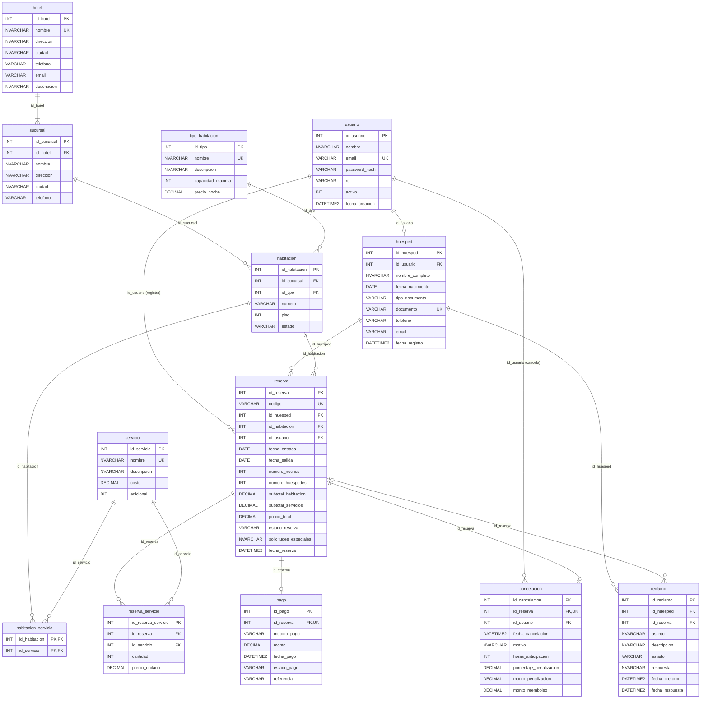

# Modelo relacional – HotelDB

Este documento presenta el **modelo relacional** de la base de datos. Se diferencia del Diagrama Entidad-Relación (DER) de la Fase 1 porque ya no muestra entidades abstractas, sino **tablas, columnas, claves primarias, claves foráneas y restricciones** tal como se implementan en SQL Server (`database/01_HotelDB_esquema.sql`).

## 1. Esquema relacional

Notación: <u>subrayado</u> = clave primaria, `#campo` = clave foránea.

| Tabla | Esquema |
|---|---|
| usuario | usuario(<u>id_usuario</u>, nombre, email, password_hash, rol, activo, fecha_creacion) |
| hotel | hotel(<u>id_hotel</u>, nombre, direccion, ciudad, telefono, email, descripcion) |
| sucursal | sucursal(<u>id_sucursal</u>, `#id_hotel`, nombre, direccion, ciudad, telefono) |
| tipo_habitacion | tipo_habitacion(<u>id_tipo</u>, nombre, descripcion, capacidad_maxima, precio_noche) |
| habitacion | habitacion(<u>id_habitacion</u>, `#id_sucursal`, `#id_tipo`, numero, piso, estado) |
| servicio | servicio(<u>id_servicio</u>, nombre, descripcion, costo, adicional) |
| habitacion_servicio | habitacion_servicio(<u>`#id_habitacion`, `#id_servicio`</u>) |
| huesped | huesped(<u>id_huesped</u>, `#id_usuario`, nombre_completo, fecha_nacimiento, tipo_documento, documento, telefono, email, fecha_registro) |
| reserva | reserva(<u>id_reserva</u>, codigo, `#id_huesped`, `#id_habitacion`, `#id_usuario`, fecha_entrada, fecha_salida, numero_noches, numero_huespedes, subtotal_habitacion, subtotal_servicios, precio_total, estado_reserva, solicitudes_especiales, fecha_reserva) |
| reserva_servicio | reserva_servicio(<u>id_reserva_servicio</u>, `#id_reserva`, `#id_servicio`, cantidad, precio_unitario) |
| pago | pago(<u>id_pago</u>, `#id_reserva`, metodo_pago, monto, fecha_pago, estado_pago, referencia) |
| cancelacion | cancelacion(<u>id_cancelacion</u>, `#id_reserva`, `#id_usuario`, fecha_cancelacion, motivo, horas_anticipacion, porcentaje_penalizacion, monto_penalizacion, monto_reembolso) |
| reclamo | reclamo(<u>id_reclamo</u>, `#id_huesped`, `#id_reserva`, asunto, descripcion, estado, respuesta, fecha_creacion, fecha_respuesta) |

## 2. Relaciones (claves foráneas)

| Relación | Cardinalidad | Clave foránea | Regla |
|---|---|---|---|
| hotel → sucursal | 1 : N | sucursal.id_hotel → hotel.id_hotel | No se elimina un hotel con sucursales |
| sucursal → habitacion | 1 : N | habitacion.id_sucursal → sucursal.id_sucursal | No se elimina una sucursal con habitaciones |
| tipo_habitacion → habitacion | 1 : N | habitacion.id_tipo → tipo_habitacion.id_tipo | El tipo define capacidad y tarifa |
| habitacion ↔ servicio | N : M | tabla habitacion_servicio | ON DELETE CASCADE |
| usuario → huesped | 1 : 0..1 | huesped.id_usuario → usuario.id_usuario | Índice único filtrado (permite NULL) |
| huesped → reserva | 1 : N | reserva.id_huesped → huesped.id_huesped | |
| habitacion → reserva | 1 : N | reserva.id_habitacion → habitacion.id_habitacion | Sin cruces de fechas en reservas activas |
| usuario → reserva | 1 : N | reserva.id_usuario → usuario.id_usuario | Quién registró la reserva |
| reserva ↔ servicio | N : M | tabla reserva_servicio | Servicios adicionales con cantidad y precio |
| reserva → pago | 1 : 0..1 | pago.id_reserva (UNIQUE) → reserva.id_reserva | ON DELETE CASCADE |
| reserva → cancelacion | 1 : 0..1 | cancelacion.id_reserva (UNIQUE) → reserva.id_reserva | ON DELETE CASCADE |
| usuario → cancelacion | 1 : N | cancelacion.id_usuario → usuario.id_usuario | Quién canceló |
| huesped → reclamo | 1 : N | reclamo.id_huesped → huesped.id_huesped | |
| reserva → reclamo | 1 : N | reclamo.id_reserva → reserva.id_reserva | Opcional |

## 3. Diagrama del modelo relacional

> En SSMS también se puede generar el diagrama visual: clic derecho en **HotelDB > Diagramas de base de datos > Nuevo diagrama** y agregar todas las tablas.

## 4. Reglas de integridad principales

- **Integridad de entidad:** todas las tablas tienen clave primaria autoincremental (IDENTITY), excepto `habitacion_servicio`, que usa clave compuesta.
- **Integridad referencial:** las claves foráneas impiden registros huérfanos. Solo se usa `ON DELETE CASCADE` en tablas dependientes (pago, cancelación, servicios de la reserva y servicios de la habitación).
- **Unicidad:** correo de usuario, documento de huésped, código de reserva, número de habitación por sucursal y un solo pago y una sola cancelación por reserva.
- **Dominio (CHECK):** roles, estados, métodos de pago, `fecha_salida > fecha_entrada`, montos positivos, capacidad entre 1 y 10, porcentaje entre 0 y 100.
- **Reglas en la API (Spring Boot):** no se permiten reservas que se crucen en fechas para la misma habitación (con bloqueo pesimista para evitar reservas dobles), el número de huéspedes no puede superar la capacidad, la fecha de entrada no puede ser anterior a hoy y el total siempre lo calcula el servidor.

## 5. Cambios respecto a la Fase 1

| Cambio | Motivo |
|---|---|
| `tipo_habitacion.precio_noche` | El prototipo mostraba un precio por noche que no estaba en ninguna tabla. |
| `usuario.activo` | La rúbrica exige activar y desactivar usuarios. |
| `huesped.id_usuario` | Relaciona la cuenta con su perfil de huésped para que vea solo sus reservas. |
| `huesped.tipo_documento` | Validar el formato según sea DUI o pasaporte. |
| `servicio.adicional` | Distinguir servicios incluidos (WiFi) de los que se cobran (traslado). |
| Tabla `reserva_servicio` | Servicios adicionales contratados en cada reserva (antes no existía). |
| Tabla `cancelacion` | El módulo de cancelaciones con penalización no tenía tabla. |
| Tabla `reclamo` | Los reclamos se mencionaban en los objetivos, pero no tenían tabla. |
| `reserva.codigo`, `numero_huespedes`, subtotales e `id_usuario` | Código visible para el cliente, control de capacidad y desglose del total. |
| `reserva.solicitudes_especiales` (antes en huésped) | Las solicitudes son de cada estadía, no de la persona. |
| Estado `EN_CURSO` en reserva | Representa el período entre el check-in y el check-out. |
| `sucursal.ciudad` | La búsqueda por ciudad se hace sobre la ubicación de cada sede. |
